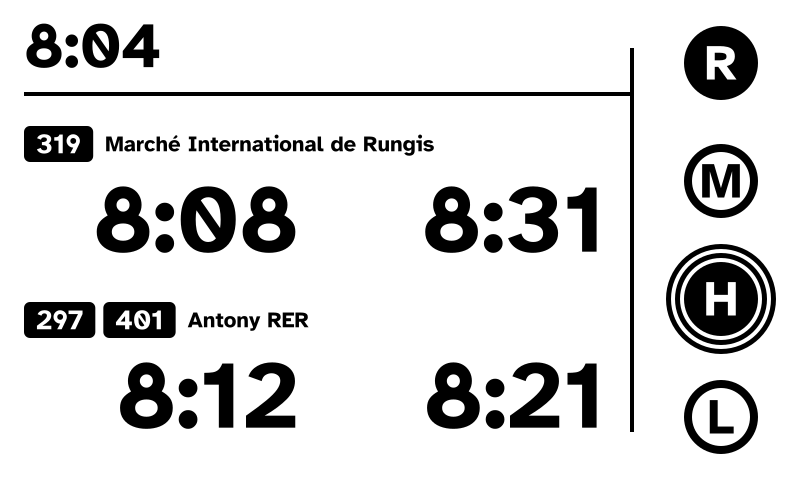
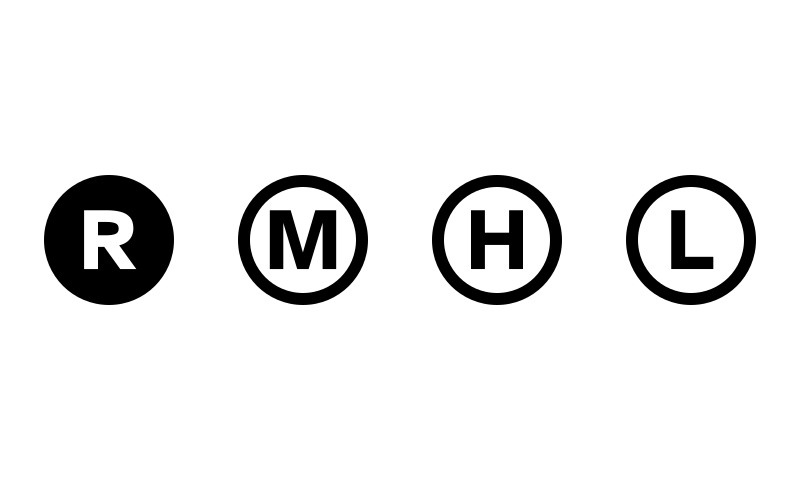
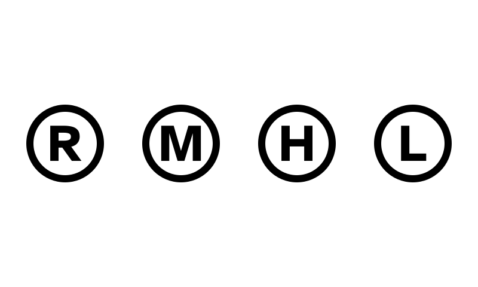

# e-paper

A household dashboard on a 7.5" black and white e-paper panel, driven by a
Raspberry Pi. It hangs in a shared room and answers two questions at a
glance: **who is home**, and **should I hurry for the next bus or wait for
the following one**.

Written in Rust, from the panel driver up. It is also a learning project in
Rust and embedded Linux.

<p align="center">
  
</p>

## Screens

The panel is 800×480 pixels, pure black and white. Everything is drawn in
large, thick type (Atkinson Hyperlegible Bold) so that it reads from across
the room, and each piece of information always sits in the same place.

### Next departures and presence (current)

- **Clock** at the top left.
- **Two directions**, stacked: line 319 to Rungis, lines 297 and 401 to
  Antony RER. Each shows its next two departure times, lines merged, as
  clock times ("8:08", never a countdown). Only departures still catchable
  are shown (at least 5 minutes away, the time to walk to the stop).
- **Presence**, on the right: one circle per household member, in a fixed
  order. Filled with a white letter means home; an outline with a black
  letter means away. A double ring marks heavy network use (a video or a
  large download), with no detail on what is used.

When no departure can be shown, a pictogram takes the place of the times
instead of leaving stale ones on the panel:

<table>
  <tr>
    <td width="50%"></td>
    <td width="50%"></td>
  </tr>
  <tr>
    <td><b>Moon</b>: the service of that direction is over for the day, or
      not started yet.</td>
    <td><b>Wrench</b>: the bus data has been unavailable for two polls in a
      row.</td>
  </tr>
</table>

### Presence only (first version)

The first version showed presence alone, in larger circles:

<table>
  <tr>
    <td width="33%"></td>
    <td width="33%"></td>
    <td width="33%"></td>
  </tr>
  <tr>
    <td>R is home, the others are away.</td>
    <td>Nobody is home.</td>
    <td>R and H are home; H is using the network heavily.</td>
  </tr>
</table>

The mockups in [`docs/mockups/`](docs/mockups/) print at true scale (the
panel's active area is 163.2 × 97.92 mm), to check sizes on paper at the
viewing distance.

## How it works

- **Presence** comes from the home router (a Freebox): a person is home if
  their smartphone was active on the Wi-Fi in the last 5 minutes. Each
  device is assigned to a person in a local mapping file. Nobody has to do
  anything: only passive signals are used.
- **Departures** come from the real-time
  [PRIM API](https://prim.iledefrance-mobilites.fr/) of Île-de-France
  Mobilités (SIRI Lite `stop-monitoring`), polled every 5 minutes during the
  day and every 15 minutes at night.
- **One cycle a minute**, run by a systemd timer: poll, compute the new
  screen, and redraw only what changed with a partial refresh (no flashing).
  A full refresh once an hour clears the ghosting. State is kept in a small
  JSON file between runs.
- **Privacy**: the panel only shows connection state and an aggregated
  activity mark, never what anyone is doing. Device names, MAC addresses,
  tokens and home stops are never committed.

## Hardware

| Part | Details |
|---|---|
| Display | Waveshare 7.5" e-paper raw panel, black/white V2, 800×480, SPI |
| Wiring | Panel ribbon → adapter board → Raspberry Pi GPIO |
| Computer | Raspberry Pi 3B, Raspberry Pi OS Bookworm 64-bit |
| Enclosure | Laser-cut plywood box |

## Software

- Rust (toolchain pinned in [`rust-toolchain.toml`](rust-toolchain.toml)).
- Own e-paper driver (`src/epd/`), a port of the Waveshare Python driver on
  the `embedded-hal` 1.0 traits, with partial refresh.
- Rendering with `embedded-graphics`; text rasterised from the embedded TTF
  with `fontdue`.
- HTTPS with `ureq` and `rustls` (no OpenSSL); times with `jiff`, time zone
  database bundled.
- Static binary for `aarch64-unknown-linux-musl`, cross-compiled with
  `cargo-zigbuild`.

## Getting started

Set up the development machine and the Pi first:
[`docs/dev-environment-setup.md`](docs/dev-environment-setup.md).

Run the tests:

```bash
cargo test
```

Render the mockup screens as PNG files in `target/mockups/`, or open one in
the simulator window (needs SDL2):

```bash
cargo run --example mockups -- png
cargo run --example mockups -- show phase2-buses-presence
```

List the commands (`authorize`, `devices`, `run`, `test-pattern`, `clear`…):

```bash
cargo run -- --help
```

Deploy to the Pi (SSH alias `epaper`; one-time setup in
[`docs/guide-07-autonomy.md`](docs/guide-07-autonomy.md)):

```bash
make deploy
make status
make logs
```

On the Pi, secrets and personal data live in `/etc/e-paper/` (root only)
and reach the service as systemd credentials: the Freebox app token, the
device mapping `devices.toml`, the PRIM API key, and the home stops in
`prim.env`.

## Documentation

The project was built step by step; each step has a guide in
[`docs/`](docs/):

| Guide | Topic |
|---|---|
| [01](docs/guide-01-project-skeleton.md) | Cargo project skeleton |
| [02](docs/guide-02-presence-logic.md) | Presence logic |
| [03](docs/guide-03-first-render.md) | First render (presence screen) |
| [04](docs/guide-04-freebox-devices.md) | Freebox authorization and device list |
| [05](docs/guide-05-full-cycle.md) | One full cycle |
| [06](docs/guide-06-epd-driver.md) | E-paper driver |
| [07](docs/guide-07-autonomy.md) | Autonomy on the Pi (systemd) |
| [08](docs/guide-08-partial-refresh.md) | Partial refresh, one cycle a minute |
| [09](docs/guide-09-bus-observation.md) | Observing the PRIM answers |
| [10](docs/guide-10-usage-log.md) | Usage log (activity threshold check) |
| [11](docs/guide-11-phase2-render.md) | Departures screen render |
| [12](docs/guide-12-prim-departures.md) | PRIM departures |
| [13](docs/guide-13-phase2-screen-states.md) | Moon and wrench screens |
| [14](docs/guide-14-phase2-cycle.md) | Departures cycle |

Also: [panel smoke test](docs/panel-smoke-test.md),
[decommissioning the previous setup](docs/decommission-inventory.md).

## Licence

[MIT](LICENSE). Bundled third-party assets keep their own licences:
Atkinson Hyperlegible font ([SIL Open Font License](assets/fonts/OFL.txt)),
moon and wrench pictograms from Tabler Icons
([MIT](assets/icons/LICENSE-tabler-icons.txt)).
