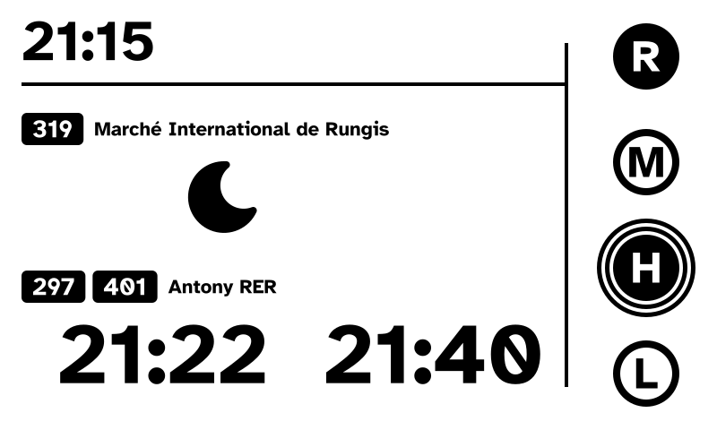
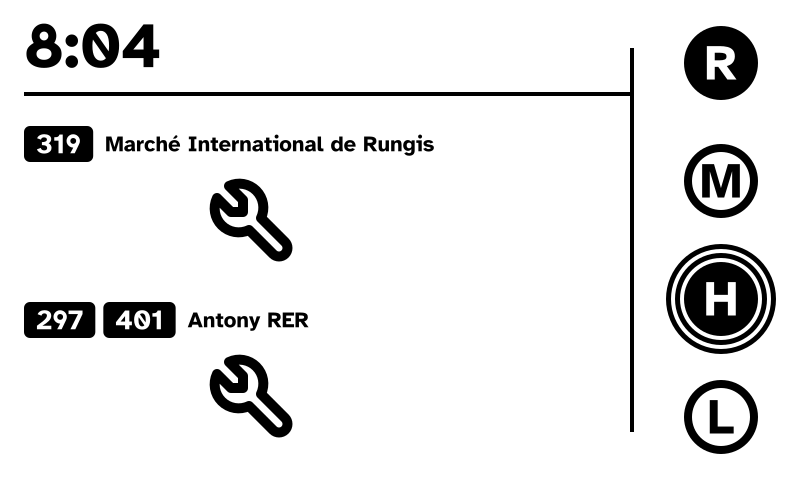

# Guide 13: phase 2 screen states (moon, wrench, Paris time)

The phase 2 screen learns its two other states (CLAUDE.md "Phase 2",
"No-departure pictograms"): the **moon** when a direction's service is over
or not started yet, the **wrench** after two failed PRIM polls. Departure
times become **Paris times**, truncated to the minute. Still pure functions:
polling, saving the answers and wiring into `e-paper run` come in guide 14.

<table>
  <tr>
    <td width="50%"></td>
    <td width="50%"></td>
  </tr>
  <tr>
    <td><code>phase2-end-of-service</code>: moon for Rungis</td>
    <td><code>phase2-bus-data-unavailable</code>: wrench in both blocks</td>
  </tr>
</table>

| Item | Content | Tests |
|---|---|---|
| `jiff` | time zone database bundled in the binary | |
| `assets/icons/` (new) | `moon.png`, `wrench.png`, 1-bit 96 px, Tabler licence | |
| `frame` | PNG decoding of any size, shared with the icons | existing |
| `icons` (new) | the two pictograms | D (8) |
| `board` | a direction shows a `Block`: times, moon or wrench | C (6–7) |
| `render` | draws a pictogram | E (9) |
| `departures` | `paris_time`, `block` | A, B (1–5) |
| golden images | end of service, bus data unavailable | F |

Approved tests: 12 (2026-10-14). Choices approved the same day: icons as
1-bit images made once by Claude from the Tabler icons drawn in the mockups;
wrench after 2 failed polls; times truncated to the minute.

Two changes while writing, against what was announced:

- The time zone database is **bundled** with `jiff` (feature
  `tzdb-bundle-always`, a few hundred KB at most) instead of read from the system:
  `paris_time` cannot fail, and the tests do not depend on the machine.
- The phase 2 golden images are checked by **one** test looping over the
  three states (like phase 1), not one test each: 2 golden tests in all.

Checked while writing this guide: it was replayed step by step on a copy of
the project (each red step fails as described, each green step passes), the
existing golden images are unchanged, clippy is clean, the Pi build works,
and the two new renders match the SVG mockups.

Run every command from the project root; edit the files in VS Code.

Test numbers follow the list approved in the conversation: A Paris time
(1–2), B block of a direction (3–5), C layout (6–7), D pictograms (8), E
render (9), F golden images (10–12, test 10 being the existing phase 2
image, which must not change). The section letters in the code comments
follow each module's own sections.

## 1. Setup

### Time zone database

```bash
cargo add jiff --features tzdb-bundle-always
```

### Pictograms

Already in `assets/icons/`, created by Claude: `moon.png` and `wrench.png`
(96×96, 1 bit, rendered from the Tabler paths of `tools/export_mockups.py`,
thresholded at mid-grey) and `LICENSE-tabler-icons.txt` (MIT). Open the two
PNGs to look at them.

### Refactor: decoding a PNG of any size

The icons are PNG files, like the frame. Move the decoding out of
`Frame::from_png` so both can use it.

In `src/frame.rs`, replace the whole `from_png` method with:

```rust
    /// Decodes an 800×480 PNG; dark pixels (below mid-grey) are black.
    pub fn from_png(bytes: &[u8]) -> Result<Self, Box<dyn Error>> {
        let (width, height, pixels) = decode_png(bytes)?;
        if (width, height) != (WIDTH, HEIGHT) {
            return Err(format!("expected {WIDTH}×{HEIGHT}, got {width}×{height}").into());
        }
        Ok(Self { pixels })
    }
```

Before `impl OriginDimensions for Frame {`, add:

```rust
/// Decodes a PNG of any size: its width, its height and its pixels row by row,
/// `true` for black (below mid-grey).
pub fn decode_png(bytes: &[u8]) -> Result<(u32, u32, Vec<bool>), Box<dyn Error>> {
    let mut decoder = png::Decoder::new(std::io::Cursor::new(bytes));
    // Expands every format to 8 bits per channel; the first channel is enough.
    decoder.set_transformations(png::Transformations::EXPAND);
    let mut reader = decoder.read_info()?;
    let mut buffer = vec![0; reader.output_buffer_size().ok_or("PNG too large")?];
    let info = reader.next_frame(&mut buffer)?;
    let channels = info.line_size / info.width as usize;
    let pixels = buffer[..info.buffer_size()]
        .chunks(info.line_size)
        .flat_map(|row| row.chunks(channels).map(|pixel| pixel[0] < 128))
        .collect();
    Ok((info.width, info.height, pixels))
}
```

```bash
cargo test
```

Expected: everything still passes (`173 passed`, `2 passed`): a refactor changes no behaviour.

## 2. `icons`: the pictograms (test 8)

**D. Pictograms**

8. `icons_are_96_px_and_have_black_pixels`: each embedded PNG is 96×96 and
   has more than 1,000 black pixels (the moon about 3,300, the wrench about
   2,800): a blank or mis-sized file fails.

### Red

Create the file `src/icons.rs` with this content:

```rust
//! The phase 2 pictograms: 1-bit 96 px images embedded in the binary.
//!
//! Made once from Tabler Icons (MIT licence, `assets/icons/`), as drawn in
//! the mockups (`tools/export_mockups.py`).

use crate::frame::decode_png;

/// Width and height of a pictogram, the height of a departure time.
pub const ICON_SIZE: u32 = 96;

#[derive(Debug, Clone, Copy, PartialEq, Eq)]
pub enum Icon {
    /// The direction's service is over, or not started yet.
    Moon,
    /// The bus data is unavailable.
    Wrench,
}

impl Icon {
    /// The pixels, row by row, `true` for black.
    pub fn pixels(self) -> Vec<bool> {
        todo!()
    }
}

#[cfg(test)]
mod tests {
    use super::*;

    // D. Pictograms

    #[test]
    fn icons_are_96_px_and_have_black_pixels() {
        for (icon, png) in [
            (Icon::Moon, &include_bytes!("../assets/icons/moon.png")[..]),
            (
                Icon::Wrench,
                &include_bytes!("../assets/icons/wrench.png")[..],
            ),
        ] {
            let (width, height, _) = decode_png(png).unwrap();
            assert_eq!((width, height), (ICON_SIZE, ICON_SIZE), "{icon:?}");
            let black = icon.pixels().iter().filter(|&&black| black).count();
            assert!(black > 1000, "{icon:?}: {black} black pixels");
        }
    }
}
```

In `src/lib.rs`, after `pub mod freebox_client;`, add:

```rust
pub mod icons;
```

```bash
cargo test --lib icons::
```

Expected: the test fails with `not yet implemented`.

### Green

In `pixels`, replace `todo!()` with:

```rust
        let png: &[u8] = match self {
            Icon::Moon => include_bytes!("../assets/icons/moon.png"),
            Icon::Wrench => include_bytes!("../assets/icons/wrench.png"),
        };
        let (_, _, pixels) = decode_png(png).expect("embedded icon is a valid PNG");
        pixels
```

```bash
cargo test --lib icons::
```

Expected: `1 passed`, no warning.

## 3. `board`: blocks and pictograms (tests 6–7)

**C. Layout**

6. `moon_is_right_aligned_in_the_first_cell`: a Rungis moon is a 96 px
   pictogram at (203, 172), the place of a right-aligned time in the first
   cell (right edge 299); no time nor dash in that block; Antony keeps its
   two cells.
7. `wrench_is_in_both_blocks`: the wrench at (203, 172) and (203, 348), no
   time in either block.

A direction no longer takes a list of times but a `Block`: `Times` (as
before), `Moon` or `Wrench`. The existing tests keep checking the same
things through `Block::Times`.

### Red

In `src/board.rs`:

after `use fontdue::Font;` (and its blank line), add:

```rust
use crate::icons::Icon;
```

replace the `Board` struct (and its comment) with:

```rust
/// What a direction block shows below its header.
#[derive(Debug, Clone, PartialEq, Eq)]
pub enum Block {
    /// The next departures, already chosen and sorted; only the first two
    /// are shown, a missing one as a dash.
    Times(Vec<Time>),
    /// The service is over, or not started yet.
    Moon,
    /// The bus data is unavailable.
    Wrench,
}

/// What the bus part shows: the clock and each direction's block.
#[derive(Debug, Clone, PartialEq, Eq)]
pub struct Board {
    pub clock: Time,
    pub rungis: Block,
    pub antony: Block,
}
```

replace the `Element` enum (and its comment) with:

```rust
/// A pictogram, `ICON_SIZE` px square, from its top left corner.
#[derive(Debug, Clone, Copy, PartialEq, Eq)]
pub struct Pictogram {
    pub icon: Icon,
    pub x: i32,
    pub y: i32,
}

/// Something to draw, in drawing order.
#[derive(Debug, Clone, PartialEq)]
pub enum Element {
    Rect(Rect),
    Text(Text),
    Pictogram(Pictogram),
}
```

in `direction`, replace the last parameter `departures: &[Time],` with `block: &Block,`:

```rust
    label: &str,
    block: &Block,
) {
```

and before `for cell in 0..2 {`, add:

```rust
    // Red step: every block shows its times, pictograms come next.
    let departures: &[Time] = match block {
        Block::Times(departures) => departures,
        Block::Moon | Block::Wrench => &[],
    };
```

In the tests of `src/board.rs`:

split `mockup_layout`: replace its first two lines with:

```rust
    fn mockup_layout(rungis: Vec<Time>, antony: Vec<Time>) -> BoardLayout {
        blocks_layout(Block::Times(rungis), Block::Times(antony))
    }

    fn blocks_layout(rungis: Block, antony: Block) -> BoardLayout {
        let board = Board {
```

in `texts`, replace the `Element::Rect(_) => None,` arm with `_ => None,`:

```rust
                Element::Text(text) => Some(text),
                _ => None,
```

in `rects`, the same for `Element::Text(_) => None,`:

```rust
                Element::Rect(rect) => Some(*rect),
                _ => None,
```

before `fn close`, add:

```rust
    fn pictograms(layout: &BoardLayout) -> Vec<Pictogram> {
        layout
            .elements
            .iter()
            .filter_map(|element| match element {
                Element::Pictogram(pictogram) => Some(*pictogram),
                _ => None,
            })
            .collect()
    }
```

before `// C. Everything fits, measured with the real font`, add the two tests:

```rust
    #[test]
    fn moon_is_right_aligned_in_the_first_cell() {
        let layout = blocks_layout(Block::Moon, Block::Times(vec![at(21, 22)]));
        assert_eq!(
            pictograms(&layout),
            [Pictogram {
                icon: Icon::Moon,
                x: 203,
                y: 172
            }]
        );
        assert!(times_at(&layout, 172.0).is_empty());
        assert_eq!(times_at(&layout, 348.0).len(), 2);
    }

    #[test]
    fn wrench_is_in_both_blocks() {
        let layout = blocks_layout(Block::Wrench, Block::Wrench);
        assert_eq!(
            pictograms(&layout),
            [
                Pictogram {
                    icon: Icon::Wrench,
                    x: 203,
                    y: 172
                },
                Pictogram {
                    icon: Icon::Wrench,
                    x: 203,
                    y: 348
                },
            ]
        );
        assert!(times_at(&layout, 172.0).is_empty() && times_at(&layout, 348.0).is_empty());
    }
```

In `src/render.rs`, the board must handle the new element:

replace the `use crate::board::…` line with:

```rust
use crate::board::{BoardLayout, Element, Pictogram, Rect, Text};
```

in `render_board`, add an arm to the `match`:

```rust
            Element::Text(text) => draw_text(target, text, font)?,
            Element::Pictogram(pictogram) => draw_pictogram(target, pictogram)?,
        }
```

before `/// Draws a line of text glyph by glyph`, add (drawn in section 4):

```rust
/// Draws the black pixels of a pictogram.
fn draw_pictogram<D>(target: &mut D, pictogram: &Pictogram) -> Result<(), D::Error>
where
    D: DrawTarget<Color = BinaryColor>,
{
    todo!()
}
```

in its `mod board` tests, replace the `use crate::board::…` line with:

```rust
        use crate::board::{Block, Board, Time, board_layout};
```

and split `rendered_board`: replace its first two lines with:

```rust
        fn rendered_board(rungis: Vec<Time>, antony: Vec<Time>) -> Frame {
            rendered_blocks(Block::Times(rungis), Block::Times(antony))
        }

        fn rendered_blocks(rungis: Block, antony: Block) -> Frame {
            let font = atkinson_bold();
```

In `src/mockups.rs`, the phase 2 mockup wraps its times:

replace `use crate::board::{Board, Time};` with:

```rust
use crate::board::{Block, Board, Time};
```

and the two `rungis` and `antony` lines with:

```rust
            rungis: Block::Times(vec![at(8, 8), at(8, 31)]),
            antony: Block::Times(vec![at(8, 12), at(8, 21)]),
```

```bash
cargo test --lib board::
```

Expected: warnings `unused variable` for the parameters of `draw_pictogram`; the two new tests fail (no pictogram yet, dashes instead), the others pass.

### Green

In `src/board.rs`:

replace `use crate::icons::Icon;` with:

```rust
use crate::icons::{ICON_SIZE, Icon};
```

replace the end of `direction`, from `// Red step: every block shows its times` to the end of the function, with the code below. It places the
pictogram, and moves the two cells into a function of their own:

```rust
    let time_top = top + TIMES_OFFSET;
    let icon = match block {
        Block::Times(departures) => return times(elements, font, departures, time_top),
        Block::Moon => Icon::Moon,
        Block::Wrench => Icon::Wrench,
    };
    // Right-aligned in the first cell, like a time; the second cell stays
    // empty.
    elements.push(Element::Pictogram(Pictogram {
        icon,
        x: MARGIN + CELL_WIDTH - ICON_SIZE as i32,
        y: time_top,
    }));
}

/// The two departure cells, a dash for a missing departure.
fn times(elements: &mut Vec<Element>, font: &Font, departures: &[Time], time_top: i32) {
    for cell in 0..2 {
        let right = MARGIN + cell * (CELL_WIDTH + CELL_GAP) + CELL_WIDTH;
        let content = departures
            .get(cell as usize)
            .map_or(NO_DEPARTURE.to_string(), Time::to_string);
        let width = text_width(font, &content, TIME_SIZE);
        elements.push(Element::Text(text(
            font,
            &content,
            TIME_SIZE,
            right as f32 - width,
            time_top as f32,
            TIME_SIZE as f32,
            Ink::Black,
        )));
    }
}
```

```bash
cargo test --lib board::
```

Expected: all `board` tests pass. The two `unused variable` warnings of `draw_pictogram` stay until section 4.

## 4. `render`: drawing a pictogram (test 9)

**E. Render**

9. `pictogram_is_drawn`: with a Rungis moon, the pixel 24 px right and 48 px
   down from the cell corner (203, 172), in the solid part of the moon, is
   black; the pixel at (2, 2) from the corner is white.

### Red

In `src/render.rs`, in the `mod board` tests, before `fn phase_2_background_is_white`, add:

```rust
        #[test]
        fn pictogram_is_drawn() {
            let frame = rendered_blocks(Block::Moon, Block::Times(vec![]));
            // The moon's cell starts at (203, 172): its solid part is black,
            // the corner of its square white.
            assert!(frame.is_black(203 + 24, 172 + 48));
            assert!(!frame.is_black(203 + 2, 172 + 2));
        }
```

```bash
cargo test --lib render::
```

Expected: `pictogram_is_drawn` fails with `not yet implemented`.

### Green

After the `use crate::board::…` line, add `use crate::icons::ICON_SIZE;`:

```rust
use crate::board::{BoardLayout, Element, Pictogram, Rect, Text};
use crate::icons::ICON_SIZE;
```

In `draw_pictogram`, replace `todo!()` with:

```rust
    let size = ICON_SIZE as i32;
    let pixels = pictogram.icon.pixels();
    let black = (0..size * size)
        .filter(|&index| pixels[index as usize])
        .map(|index| {
            Pixel(
                Point::new(pictogram.x + index % size, pictogram.y + index / size),
                BinaryColor::On,
            )
        });
    target.draw_iter(black)
}

/// Draws a line of text
```

```bash
cargo test --lib render::
```

Expected: all `render` tests pass, no warning.

## 5. `departures`: Paris time and blocks (tests 1–5)

**A. Paris time**

1. `paris_time_is_truncated_to_the_minute`: 06:08:36 UTC is 8:08 in Paris
   (summer time), not 8:09.
2. `paris_time_follows_daylight_saving`: on 2026-10-25, 00:30 UTC is 2:30
   (summer time) and 01:30 UTC is 2:30 too (winter time, the clocks went
   back at 01:00 UTC); 2026-12-01 12:00 UTC is 13:00.

**B. Block of a direction**

3. `next_departures_become_paris_times`: departures at 06:13:00 and
   06:20:43 UTC give the times 8:13 and 8:20.
4. `service_over_gives_the_moon`: Rungis at 20:40 (fixture) gives the moon.
5. `two_failed_polls_give_the_wrench`: 0 or 1 failed poll gives the times of
   the last answer; 2 give the wrench, even with times known.

### Red

In `src/departures.rs`:

replace the line `//! Times stay UTC instants here…` of the module comment with:

```rust
//! Times are UTC instants until `block` turns them into Paris times.
```

after `use serde::Deserialize;`, add:

```rust
use serde::Deserialize;

use crate::board::{Block, Time};

/// A departure less than this away is hidden: time to reach the stop.
pub const MIN_LEAD: SignedDuration = SignedDuration::from_mins(5);

/// After this many failed polls in a row, the block shows the wrench.
pub const FAILURES_BEFORE_WRENCH: u32 = 2;
```

before `#[cfg(test)]`, add:

```rust
/// The time of day in Paris, daylight saving included, truncated to the
/// minute: a bus is never shown later than it leaves.
pub fn paris_time(at: Timestamp) -> Time {
    todo!()
}

/// What a direction block shows, from the last answer of its pole and the
/// number of failed polls since.
pub fn block(answer: &Answer, failures: u32, now: Timestamp) -> Block {
    todo!()
}
```

at the end of the tests, before their closing `}`, add:

```rust

    // C. Paris time

    fn hm(hour: u8, minute: u8) -> Time {
        Time { hour, minute }
    }

    #[test]
    fn paris_time_is_truncated_to_the_minute() {
        assert_eq!(paris_time(at("2026-10-14T06:08:36Z")), hm(8, 8));
    }

    #[test]
    fn paris_time_follows_daylight_saving() {
        // Summer time ends on 2026-10-25 at 01:00 UTC (03:00 becomes 02:00).
        assert_eq!(paris_time(at("2026-10-25T00:30:00Z")), hm(2, 30));
        assert_eq!(paris_time(at("2026-10-25T01:30:00Z")), hm(2, 30));
        assert_eq!(paris_time(at("2026-12-01T12:00:00Z")), hm(13, 0));
    }

    // D. Block of a direction

    #[test]
    fn next_departures_become_paris_times() {
        let answer = departures(&[
            (LINE_297, "2026-10-14T06:20:43Z"),
            (LINE_401, "2026-10-14T06:13:00Z"),
        ]);
        assert_eq!(
            block(&answer, 0, at("2026-10-14T06:00:00Z")),
            Block::Times(vec![hm(8, 13), hm(8, 20)])
        );
    }

    #[test]
    fn service_over_gives_the_moon() {
        let answer = parse(RUNGIS_EVENING, Direction::Rungis).unwrap();
        assert_eq!(block(&answer, 0, at("2026-10-13T18:40:00Z")), Block::Moon);
    }

    #[test]
    fn two_failed_polls_give_the_wrench() {
        let answer = departures(&[(LINE_319, "2026-10-14T06:13:00Z")]);
        let now = at("2026-10-14T06:00:00Z");
        let times = Block::Times(vec![hm(8, 13)]);
        assert_eq!(block(&answer, 0, now), times);
        assert_eq!(block(&answer, 1, now), times);
        assert_eq!(block(&answer, 2, now), Block::Wrench);
    }
```

```bash
cargo test --lib departures::
```

Expected: warnings `unused variable` (the parameters of the two `todo!()`); the 5 new tests fail, the 16 others pass.

### Green

Before `use jiff::{SignedDuration, Timestamp};`, add `use jiff::tz::TimeZone;`:

```rust
use jiff::tz::TimeZone;
use jiff::{SignedDuration, Timestamp};
```

In `paris_time`, replace `todo!()` with:

```rust
pub fn paris_time(at: Timestamp) -> Time {
    let paris = TimeZone::get("Europe/Paris").expect("time zone database bundled with jiff");
    let local = at.to_zoned(paris);
    Time {
        hour: local.hour() as u8,
        minute: local.minute() as u8,
    }
```

In `block`, replace `todo!()` with:

```rust
pub fn block(answer: &Answer, failures: u32, now: Timestamp) -> Block {
    if failures >= FAILURES_BEFORE_WRENCH {
        return Block::Wrench;
    }
    match next(answer, now, MIN_LEAD) {
        Next::ServiceOver => Block::Moon,
        Next::Times(times) => Block::Times(times.into_iter().map(paris_time).collect()),
    }
```

```bash
cargo test --lib departures::
```

Expected: `21 passed`, no warning.

## 6. Golden images (tests 10–12)

**F. Golden images**

10. The existing phase 2 image `phase2-buses-presence.png` is unchanged.
11. The end of service screen (21:15, Rungis moon, Antony 21:22 and 21:40)
    matches `tests/golden/phase2-end-of-service.png`.
12. The bus data unavailable screen (8:04, wrench in both blocks) matches
    `tests/golden/phase2-bus-data-unavailable.png`.

The phase 2 mockups become a list, like phase 1. In `src/mockups.rs`,
replace the whole `phase2_state` function (and its comment) with:

```rust
/// Name, board and household of each phase 2 mockup.
pub fn phase2_states() -> [(&'static str, Board, HouseholdState); 3] {
    let at = |hour, minute| Time { hour, minute };
    let household = || -> HouseholdState {
        [(Person('R'), HomePassive), (Person('H'), HomeActive)]
            .into_iter()
            .collect()
    };
    [
        (
            "phase2-buses-presence",
            Board {
                clock: at(8, 4),
                rungis: Block::Times(vec![at(8, 8), at(8, 31)]),
                antony: Block::Times(vec![at(8, 12), at(8, 21)]),
            },
            household(),
        ),
        (
            "phase2-end-of-service",
            Board {
                clock: at(21, 15),
                rungis: Block::Moon,
                antony: Block::Times(vec![at(21, 22), at(21, 40)]),
            },
            household(),
        ),
        (
            "phase2-bus-data-unavailable",
            Board {
                clock: at(8, 4),
                rungis: Block::Wrench,
                antony: Block::Wrench,
            },
            household(),
        ),
    ]
}
```

In `tests/golden.rs`:

replace `use e_paper::mockups::{phase1_states, phase2_state};` with:

```rust
use e_paper::mockups::{phase1_states, phase2_states};
```

and replace the whole test `phase_2_render_matches_the_golden_image` with:

```rust
#[test]
fn phase_2_renders_match_the_golden_images() {
    let font = atkinson_bold();
    for (name, board, household) in phase2_states() {
        let path = Path::new("tests/golden").join(format!("{name}.png"));
        let golden = Frame::from_png(&fs::read(&path).unwrap()).unwrap();

        let mut frame = Frame::new();
        render_board(&mut frame, &board_layout(&board, &household, &font), &font).unwrap();

        assert!(
            frame == golden,
            "{name}: the render differs from {}",
            path.display()
        );
    }
}
```

In `examples/mockups.rs`:

replace the two `//! NAME is one of…` lines with:

```rust
//! NAME is one of `phase1-r-home`, `phase1-all-away`, `phase1-activity-ring`,
//! `phase2-buses-presence`, `phase2-end-of-service`,
//! `phase2-bus-data-unavailable`.
```

replace `use e_paper::mockups::{phase1_states, phase2_state};` with:

```rust
use e_paper::mockups::{phase1_states, phase2_states};
```

in `write_pngs`, replace everything from `let (name, board, household) = phase2_state();` to `Ok(())` with:

```rust
    for (name, board, household) in phase2_states() {
        let mut frame = Frame::new();
        render_board(&mut frame, &board_layout(&board, &household, &font), &font)?;
        let path = dir.join(format!("{name}.png"));
        fs::write(&path, frame.to_png())?;
        println!("{}", path.display());
    }
    Ok(())
```

in `show`, replace the lines from `let (phase2_name, board, household) = phase2_state();` to `} else {` with:

```rust
    if let Some((_, board, household)) = phase2_states()
        .into_iter()
        .find(|(candidate, _, _)| *candidate == name)
    {
        render_board(
            &mut display,
            &board_layout(&board, &household, &font),
            &font,
        )?;
    } else {
```

```bash
cargo test --test golden
```

Expected: `phase_2_renders_match_the_golden_images` fails on `phase2-end-of-service`: its golden image does not exist yet. (The first phase 2 state passes: test 10.)

Render the PNGs:

```bash
cargo run --example mockups -- png
```

Compare `target/mockups/phase2-end-of-service.png` with
`docs/mockups/phase2-end-of-service.svg`, and
`target/mockups/phase2-bus-data-unavailable.png` with
`docs/mockups/phase2-bus-data-unavailable.svg` (or `cargo run --example
mockups -- show phase2-end-of-service`): same layout, same pictograms, at
the same place; the PNGs are 1-bit, so the edges are sharper. If they match,
copy them as golden images:

```bash
cp target/mockups/phase2-end-of-service.png target/mockups/phase2-bus-data-unavailable.png tests/golden/
```

```bash
cargo test --test golden
```

Expected: `2 passed`.

## 7. Checks

```bash
cargo fmt
```

```bash
cargo test
```

```bash
cargo clippy --all-targets -- -D warnings
```

```bash
cargo zigbuild --release --target aarch64-unknown-linux-musl
```

Expected: `182 passed` for the library, `2 passed` for the golden images,
no clippy warning, the Pi build succeeds (only the known linker warning).
Nothing to deploy: no command uses these screens yet.

## 8. Commit

```bash
git add -A
```

```bash
git status
```

Expected files: `Cargo.toml`, `Cargo.lock`, `assets/icons/` (3 files),
`src/frame.rs`, `src/icons.rs`, `src/lib.rs`, `src/board.rs`,
`src/render.rs`, `src/departures.rs`, `src/mockups.rs`, `tests/golden.rs`,
`tests/golden/phase2-end-of-service.png`,
`tests/golden/phase2-bus-data-unavailable.png`, `examples/mockups.rs`,
`docs/guide-13-phase2-screen-states.md`.

```bash
git commit -m "feat: phase 2 moon and wrench screens, Paris time"
```

## Report

The output of section 7, and your opinion of the two new PNGs against the
SVG mockups.
